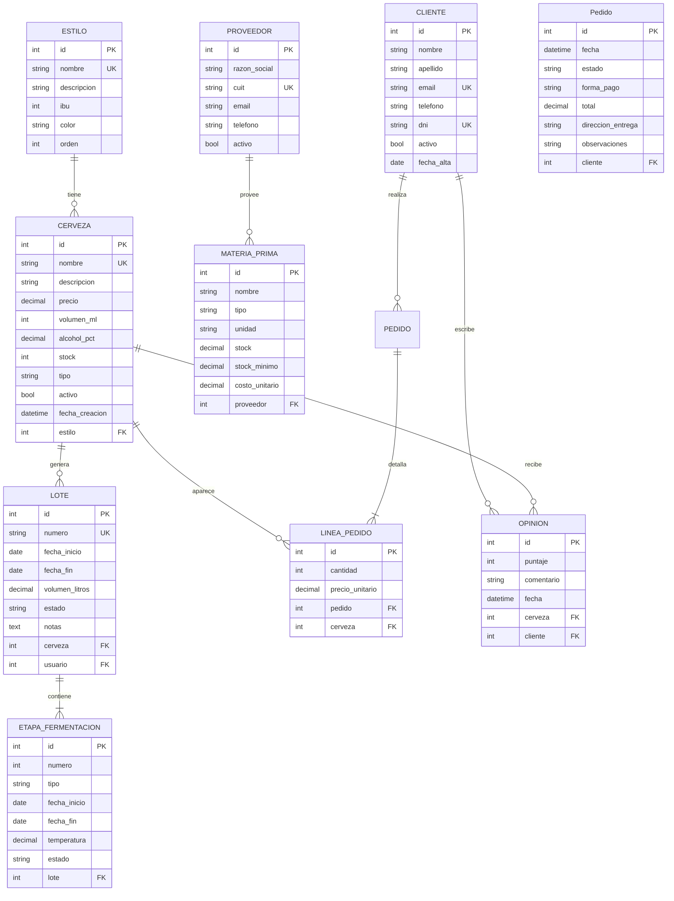
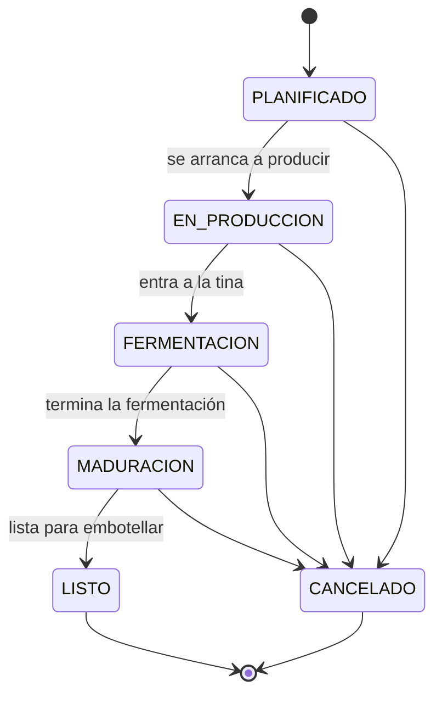
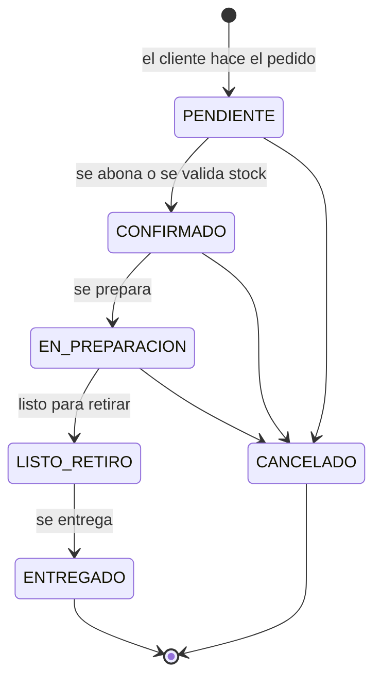

# 04 — Nuestro modelo de datos: los 10 modelos explicados

> Guía de autoaprendizaje. Equipo: Cervecería Los Flacheros — EFI Ingeniería de Software 2026.
> Todo lo de este documento vive en `backend/core/models.py` y se expone en `/api/` con DRF.
> Si vas a defender el backend, este archivo es el que tenés que poder recitar sin mirar.

---

## El negocio en una página

Antes de mirar clases de Python, entendamos la cervecería como la entiende el cervecero.

**Cervecería Los Flacheros** hace cerveza artesanal, la envasa o la sirve en grifo, y la vende a clientes. Para gestionar eso necesitamos responder cinco preguntas:

1. **¿Qué cervezas tenemos?** → `Estilo` (qué tipo de cerveza es) y `Cerveza` (el producto con su precio y stock).
2. **¿Cómo se hizo?** → `Lote` (cada producción de una cerveza) y `EtapaFermentacion` (las fases dentro de ese lote).
3. **¿Con qué la hacemos?** → `Proveedor` (quien nos vende materia prima) y `MateriaPrima` (malta, lúpulo, levadura).
4. **¿A quién le vendemos?** → `Cliente` (quién compra), `Pedido` (la orden de venta) y `LineaPedido` (cada cerveza dentro del pedido con su cantidad).
5. **¿Qué opinan?** → `Opinion` (puntaje y comentario de un cliente sobre una cerveza).

Los 10 modelos son exactamente esas 10 piezas. Nada más, nada menos.

Traducción de jerga para arrancar:

- **Modelo**: una clase de Python que Django convierte en una **tabla** de la base de datos. `class Cerveza(models.Model)` = tabla `core_cerveza`.
- **Campo**: una columna de esa tabla (`nombre`, `precio`, `stock`).
- **Instancia**: una fila concreta. La cerveza "IPA del Flachero" es una instancia del modelo `Cerveza`.
- **FK** (*foreign key*, clave foránea): un campo que apunta a una fila de otra tabla. En `Lote`, el campo `cerveza` es una FK a `Cerveza`.

> **Para la defensa:** "El modelo de datos nace del negocio: catálogo (Estilo, Cerveza), producción (Lote, EtapaFermentacion), insumos (Proveedor, MateriaPrima), ventas (Cliente, Pedido, LineaPedido) y feedback (Opinion). Son 10 modelos en una sola app, `core`."

---

## El diagrama ER

Un **diagrama ER** (*Entity-Relationship*, entidad-relación) dibuja las tablas y cómo se conectan. Este es el nuestro.



### Cómo leer un diagrama ER

Las reglas de lectura, aplicadas a la línea de arriba:

| Símbolo | Se lee | Ejemplo |
|---|---|---|
| `\|\|` | exactamente uno | Un `Lote` pertenece a **exactamente una** `Cerveza` |
| `o{` | cero o muchos | Una `Estilo` tiene **cero o muchas** `Cerveza` |
| `\|{` | uno o muchos | Un `Lote` tiene **una o muchas** `EtapaFermentacion` |
| `\|\|--o{` | "de uno a muchos" | `ESTILO \|\|--o{ CERVEZA` = un estilo, muchas cervezas |

Los tres bloques que más se estudian:

- `LOTE ||--|{ ETAPA_FERMENTACION`: un lote **no existe sin al menos una etapa**. Por eso es "uno o muchos" (`|{`) y no "cero o muchos".
- `PEDIDO ||--|{ LINEA_PEDIDO`: un pedido **necesita al menos una línea**. Un pedido vacío no tiene sentido en el negocio.
- `CERVEZA ||--o{ OPINION`: una cerveza **puede no tener ninguna opinión**, pero puede tener muchas.

Las marcas `PK`, `UK` y `FK` dentro de cada entidad:

- **PK** (*primary key*): el identificador único de la fila. Django lo agrega solo: `id`.
- **UK** (*unique*): valor único en toda la tabla. Nuestros `nombre`, `cuit`, `numero`, `email` y `dni`.
- **FK**: la conexión con otra tabla.

> **Para la defensa:** "En el diagrama ER, `||` significa exactamente uno y `o{` significa cero o muchos. Por ejemplo, `ESTILO ||--o{ CERVEZA` dice que un estilo puede tener muchas cervezas, y `PEDIDO ||--|{ LINEA_PEDIDO` dice que un pedido necesita al menos una línea."

---

## Los 10 modelos, uno por uno

### 1. `Estilo`

**Qué representa:** la receta base o categoría de cerveza: IPA, Stout, APA, Weizen. Es el catálogo de estilos, no los productos concretos.

| Campo | Tipo | Obligatorio | Qué significa |
|---|---|---|---|
| `id` | entero | automático | PK que agrega Django |
| `nombre` | texto, único | sí | "IPA", "Stout Porter". No se puede repetir |
| `descripcion` | texto | sí | Descripción para el catálogo |
| `ibu` | entero | sí | *International Bitterness Units*: cuánto amargo, escala típica 0-100 |
| `color` | texto | sí | Color estimado, por ejemplo "#F5A623" o "Ámbar" |
| `orden` | entero | sí | Orden de aparición en el catálogo del front |

**En el negocio esto es:** la ficha técnica del estilo que después el cliente ve en la web.

### 2. `Cerveza`

**Qué representa:** el producto vendible. Una cerveza con nombre propio, precio y stock.

| Campo | Tipo | Obligatorio | Qué significa |
|---|---|---|---|
| `id` | entero | automático | PK |
| `nombre` | texto, único | sí | "IPA del Flachero". No se repite |
| `descripcion` | texto | sí | Texto de venta |
| `precio` | decimal(10,2) | sí | Precio de venta, hasta 99.999.999,99 |
| `volumen_ml` | entero | sí | Ej. 473 (lata) o 500 (botella) |
| `alcohol_pct` | decimal | sí | Graduación, ej. 6.50 |
| `stock` | entero | sí | Cuántas unidades hay disponibles |
| `tipo` | texto con choices | sí | `ENVASE` (botella/lata) o `GRIFO` (línea del bar) |
| `activo` | booleano | sí | Si está en el menú o se dio de baja sin borrar |
| `fecha_creacion` | fecha y hora | automático | Cuándo se cargó en el sistema |
| `estilo` | FK a `Estilo` | sí | A qué estilo pertenece. `on_delete=PROTECT` |

**En el negocio esto es:** el producto del catálogo con su precio, su stock y su estilo.

### 3. `Lote`

**Qué representa:** una producción concreta de una cerveza. "El lote L-0042 de IPA del Flachero, arrancó el 20/10, 200 litros".

| Campo | Tipo | Obligatorio | Qué significa |
|---|---|---|---|
| `id` | entero | automático | PK |
| `numero` | texto, único | sí | Identificador del lote, ej. "L-0042" |
| `fecha_inicio` | fecha | sí | Cuándo empezó a producirse |
| `fecha_fin` | fecha | no | Puede seguir en curso (`null`) |
| `volumen_litros` | decimal | sí | Cuántos litros rinde |
| `estado` | texto con choices | sí | `PLANIFICADO`, `EN_PRODUCCION`, `FERMENTACION`, `MADURACION`, `LISTO`, `CANCELADO` |
| `notas` | texto | no | Observaciones del cervecero |
| `cerveza` | FK a `Cerveza` | sí | Qué cerveza se produce. `on_delete=PROTECT` |
| `usuario` | FK a `User` | no | Quién a cargo; al ser `SET_NULL`, si se borra el usuario el lote queda sin responsable |

**En el negocio esto es:** la orden de producción, con sus fechas y su estado.

### 4. `EtapaFermentacion`

**Qué representa:** cada fase dentro de un lote. Un lote típico tiene etapa primaria, secundaria y madurado.

| Campo | Tipo | Obligatorio | Qué significa |
|---|---|---|---|
| `id` | entero | automático | PK |
| `numero` | entero | sí | Orden dentro del lote: 1, 2, 3 |
| `tipo` | texto con choices | sí | `PRIMARIA`, `SECUNDARIA`, `MADURADO` |
| `fecha_inicio` | fecha | sí | Cuándo empieza esta etapa |
| `fecha_fin` | fecha | no | Null si sigue en curso |
| `temperatura` | decimal | sí | Temperatura objetivo, ej. 20.0 °C |
| `estado` | texto con choices | sí | `PENDIENTE`, `ACTIVA`, `COMPLETADA` |
| `lote` | FK a `Lote` | sí | A qué lote pertenece. `on_delete=CASCADE` |

**En el negocio esto es:** el control del proceso fermentativo: a qué temperatura y durante cuánto tiempo.

### 5. `Proveedor`

**Qué representa:** el que nos vende insumos: el que trae la malta o el lúpulo.

| Campo | Tipo | Obligatorio | Qué significa |
|---|---|---|---|
| `id` | entero | automático | PK |
| `razon_social` | texto | sí | Nombre legal, ej. "Maltería del Sur S.A." |
| `cuit` | texto, único | sí | CUIT argentino, ej. "30-71234567-8" |
| `email` | texto | sí | Contacto |
| `telefono` | texto | sí | Contacto |
| `activo` | booleano | sí | Si seguimos trabajando con él |

**En el negocio esto es:** la ficha del proveedor con su CUIT, que es el dato fiscal que no se puede repetir.

### 6. `MateriaPrima`

**Qué representa:** el insumo que compramos al proveedor.

| Campo | Tipo | Obligatorio | Qué significa |
|---|---|---|---|
| `id` | entero | automático | PK |
| `nombre` | texto | sí | "Malta Pilsner", "Lúpulo Cascade" |
| `tipo` | texto con choices | sí | `MALTA`, `LUPULO`, `LEVADURA`, `OTROS` |
| `unidad` | texto con choices | sí | Unidad de medida: `KG`, `G`, `LT`, `UNIDAD` |
| `stock` | decimal | sí | Cuánto tenemos |
| `stock_minimo` | decimal | sí | Umbral de alerta: si `stock < stock_minimo`, hay que recomprar |
| `costo_unitario` | decimal | sí | Cuánto nos cuesta la unidad |
| `proveedor` | FK a `Proveedor` | no | Quién nos la vende. `SET_NULL`: si se borra el proveedor, la materia prima queda sin proveedor pero no desaparece |

**En el negocio esto es:** el depósito de insumos con su stock mínimo.

### 7. `Cliente`

**Qué representa:** la persona que nos compra.

| Campo | Tipo | Obligatorio | Qué significa |
|---|---|---|---|
| `id` | entero | automático | PK |
| `nombre` | texto | sí | Nombre propio |
| `apellido` | texto | sí | Apellido |
| `email` | texto, único | sí | No se repite, se usa como contacto |
| `telefono` | texto | sí | Contacto |
| `dni` | texto, único | sí | Documento, no se repite |
| `activo` | booleano | sí | Si sigue como cliente |
| `fecha_alta` | fecha | automático | Cuándo se registró |

Además tiene una **`@property` llamada `nombre_completo`**: no es una columna de la base de datos, es un atributo calculado que devuelve `nombre + " " + apellido`. Aparece en la respuesta del API porque el serializer lo incluye.

**En el negocio esto es:** la ficha del cliente con su DNI y su mail únicos.

### 8. `Pedido`

**Qué representa:** la orden de venta a un cliente.

| Campo | Tipo | Obligatorio | Qué significa |
|---|---|---|---|
| `id` | entero | automático | PK |
| `fecha` | fecha y hora | sí | Cuándo se hizo |
| `estado` | texto con choices | sí | `PENDIENTE`, `CONFIRMADO`, `EN_PREPARACION`, `LISTO_RETIRO`, `ENTREGADO`, `CANCELADO` |
| `forma_pago` | texto con choices | sí | `EFECTIVO`, `TARJETA`, `TRANSFERENCIA` |
| `total` | decimal | sí | Suma del pedido |
| `direccion_entrega` | texto | sí | Dónde se entrega |
| `observaciones` | texto | no | Notas ("sin etiqueta", "entregar en horario de tarde") |
| `cliente` | FK a `Cliente` | sí | Quién compró. `on_delete=PROTECT` |

**En el negocio esto es:** el comprobante de venta, con su estado y su forma de pago.

### 9. `LineaPedido`

**Qué representa:** cada cerveza dentro del pedido, con su cantidad y precio. El pedido es la cabecera; la línea es el renglón.

| Campo | Tipo | Obligatorio | Qué significa |
|---|---|---|---|
| `id` | entero | automático | PK |
| `cantidad` | entero | sí | Cuántas unidades |
| `precio_unitario` | decimal | sí | Precio al momento de comprar (puede diferir del actual) |
| `pedido` | FK a `Pedido` | sí | A qué pedido pertenece. `on_delete=CASCADE` |
| `cerveza` | FK a `Cerveza` | sí | Qué cerveza se lleva. `on_delete=PROTECT` |

Tiene una **`@property` llamada `subtotal`**: devuelve `cantidad * precio_unitario`. Es un cálculo, no un campo guardado.

**En el negocio esto es:** el renglón del comprobante: "3 x IPA del Flachero a $12.500 = $37.500".

### 10. `Opinion`

**Qué representa:** la reseña de un cliente sobre una cerveza.

| Campo | Tipo | Obligatorio | Qué significa |
|---|---|---|---|
| `id` | entero | automático | PK |
| `puntaje` | entero, 1-5 | sí | Calificación |
| `comentario` | texto | sí | Texto de la reseña |
| `fecha` | fecha y hora | sí | Cuándo se escribió |
| `cerveza` | FK a `Cerveza` | sí | Sobre qué cerveza. `on_delete=CASCADE` |
| `cliente` | FK a `Cliente` | sí | Quién la escribió. `on_delete=CASCADE` |

**En el negocio esto es:** el sistema de reseñas que el frontend muestra en la ficha de cada cerveza.

> **Para la defensa:** "Los 10 modelos cubren catálogo, producción, insumos, ventas y opiniones. De cada uno puedo decir qué campo representa qué en el negocio: por ejemplo, `Lote.numero` es el identificador único de la producción, y `LineaPedido.precio_unitario` congela el precio al momento de la compra."

---

## Las relaciones y sus `on_delete`

Cuando una tabla tiene una FK hacia otra, Django te obliga a decidir: **¿qué pasa con las filas hijas si borro la fila padre?** Esa decisión se toma con `on_delete` y hay tres reglas en nuestro proyecto.

| Relación | Regla | Por qué en el negocio |
|---|---|---|
| `Cerveza.estilo` → `Estilo` | `PROTECT` | No podés borrar un estilo que tiene cervezas cargadas; primero desactivás o borrás las cervezas |
| `Lote.cerveza` → `Cerveza` | `PROTECT` | El lote es historial de producción. Borrar la cerveza no puede borrar la evidencia de que se produjo |
| `LineaPedido.cerveza` → `Cerveza` | `PROTECT` | Una venta registrada no se reescribe por el capricho de borrar un producto |
| `LineaPedido.pedido` → `Pedido` | `CASCADE` | Si borrás el pedido, sus renglones no tienen sentido: desaparecen con él |
| `EtapaFermentacion.lote` → `Lote` | `CASCADE` | Si borrás el lote, sus etapas quedan huérfanas: desaparecen con él |
| `Opinion.cerveza` → `Cerveza` | `CASCADE` | Si la cerveza ya no existe, sus reseñas tampoco tienen contexto |
| `Opinion.cliente` → `Cliente` | `CASCADE` | Mismo motivo: sin cliente no hay reseña atribuible |
| `Lote.usuario` → `User` | `SET_NULL` | Si el usuario se da de baja del sistema, el lote **sigue existiendo**, solo queda sin responsable |
| `MateriaPrima.proveedor` → `Proveedor` | `SET_NULL` | Si el proveedor deja de trabajar con nosotros, el insumo **sigue en el depósito**, solo queda sin proveedor |

Las tres reglas en una frase:

- **`PROTECT`**: "esto es histórico, no se borra". Django lanza `ProtectedError` (un `500` si no lo atrapás) si intentás borrar el padre.
- **`CASCADE`**: "esto es parte de su padre, se borra junto". En la base de datos hay un borrado en cascada.
- **`SET_NULL`**: "esto es un dato opcional; si desaparece el padre, queda en `null`". Por eso en esos campos `blank=True, null=True`.

Y una regla de modelado: **`CASCADE` solo donde la desaparición del padre sí borra el sentido del hijo**. En nuestro proyecto, `Lote` y `Pedido` son histórico y jamás deberían borrarse desde la API por eso; los hijos usan `CASCADE` para el caso de que un admin los borre a mano.

Qué pasa si "borrás mal": si no hubiera `PROTECT` y borraras una `Cerveza` que tiene 50 `LineaPedido`, desaparecerían 50 registros de ventas históricas. El total del mes dejaría de cerrar. Por eso elegimos las reglas **antes** de escribir las migraciones.

> **Para la defensa:** "Elegimos `on_delete` según el negocio: `PROTECT` en lo histórico (no se puede borrar una cerveza que tiene lotes o líneas de pedido), `CASCADE` en lo que depende de su padre (borrar el pedido borra sus líneas) y `SET_NULL` en lo opcional (si se da de baja un usuario, el lote queda sin responsable pero no se borra)."

---

## Estados como máquinas simples

Varios modelos tienen un campo `estado` con `choices`. Un `choices` (de la clase `models.TextChoices`) define **una lista cerrada de valores válidos** para ese campo.

¿Por qué `choices` y no texto libre?

- **Valida solo**: si alguien manda `"estado": "TERMINADO"` en un `PATCH`, Django devuelve `400` antes de tocar la base.
- **Documenta solo**: se leen los valores posibles mirando el modelo; el Swagger de drf-spectacular los lista como `enum`.
- **Aísla errores de tipeo**: sin `choices`, algún día aparece `"fermentacion"` con minúscula y las queries se rompen en silencio.
- **La base de datos se mantiene limpia**: no hay estados "raros" guardados.

### Máquina de estados de `Lote`



### Máquina de estados de `Pedido`



Y `EtapaFermentacion` tiene una máquina corta: `PENDIENTE` → `ACTIVA` → `COMPLETADA`.

Esto se implementa en la vista con una `@action`: en nuestro caso, `POST /api/lotes/{id}/avanzar/` pasa el lote al siguiente estado y rechaza con `400` los saltos inválidos. No guardamos la máquina en la base de datos: la máquina vive en el código, y la base guarda solo el estado actual.

> **Para la defensa:** "Los estados son listas cerradas con `choices`, lo que da validación y documentación gratis. `Lote` avanza de PLANIFICADO a LISTO pasando por la producción, y `Pedido` avanza de PENDIENTE a ENTREGADO; ambos admiten CANCELADO desde cualquier estado activo. El avance se hace con la acción `avanzar`, que valida el salto permitido."

---

## De modelo a endpoint

Cada modelo tiene su ViewSet con `DefaultRouter` montado en `/api/`. Esto es lo que se puede hacer por HTTP en cada recurso:

| Modelo | Endpoint | HTTP que funcionan | Notas |
|---|---|---|---|
| `Estilo` | `/api/estilos/` | GET, POST, GET detalle, PUT/PATCH, DELETE | Lectura para catálogo |
| `Cerveza` | `/api/cervezas/` | GET, POST, GET detalle, PUT/PATCH, DELETE | Más `@action` `GET /api/cervezas/en_grifo/` |
| `Lote` | `/api/lotes/` | GET, POST, GET detalle, PUT/PATCH, DELETE | En `list` incluye sus `etapas`; `@action` `POST /api/lotes/{id}/avanzar/` |
| `EtapaFermentacion` | `/api/etapas/` | GET, POST, GET detalle, PUT/PATCH, DELETE | CRUD estándar |
| `Proveedor` | `/api/proveedores/` | GET, POST, GET detalle, PUT/PATCH, DELETE | CRUD estándar |
| `MateriaPrima` | `/api/materias-primas/` | GET, POST, GET detalle, PUT/PATCH, DELETE | CRUD estándar |
| `Cliente` | `/api/clientes/` | GET, POST, GET detalle, PUT/PATCH, DELETE | CRUD estándar |
| `Pedido` | `/api/pedidos/` | GET, POST, GET detalle, PUT/PATCH, DELETE | En `list` incluye sus `lineas`; `@action` `GET /api/pedidos/estadisticas/` |
| `LineaPedido` | `/api/lineas/` | GET, POST, GET detalle, PUT/PATCH, DELETE | CRUD estándar |
| `Opinion` | `/api/opiniones/` | GET, POST, GET detalle, PUT/PATCH, DELETE | CRUD estándar |

Detalle del anidado, que es lo que más preguntan:

- `GET /api/lotes/` → cada lote en `results` trae **además** su lista `etapas` (anidado solo en `list`, con el patrón `get_serializer_class()`).
- `GET /api/pedidos/` → cada pedido trae **además** su lista `lineas`.
- `GET /api/lotes/1/` (detalle) → trae el lote **sin** anidar etapas. Es a propósito: el detalle se sirve con el serializer simple para no duplicar trabajo.

> **Para la defensa:** "Cada modelo tiene su ViewSet y su endpoint con `DefaultRouter` en `/api/`. Dos recursos son más ricos: `lotes` anida sus etapas y `pedidos` anida sus líneas, pero solo en la lista. Y hay dos acciones propias: `cervezas/en_grifo/` y `pedidos/estadisticas/`."

---

## Ejercicios

### 1. Mapear el negocio

Para cada frase, decí qué modelos se tocan y qué campos cambian:

a) "Entra una caja de malta Pilsner de la Maltería del Sur."
b) "Arrancamos a fermentar el lote L-0042 a 20 grados."
c) "Marcela compró 2 latas de IPA del Flachero y 1 de Stout, pagando en efectivo."
d) "El lote L-0042 quedó listo y se embotelló."

<details>
<summary>Respuestas</summary>

a) `MateriaPrima`: sube `stock` de "Malta Pilsner". El `proveedor` ya estaba cargado en la ficha de esa materia prima.
b) `Lote` L-0042: `estado` pasa a `FERMENTACION`. Y su `EtapaFermentacion` correspondiente: `tipo` = `PRIMARIA`, `temperatura` = 20.0, `estado` = `ACTIVA`.
c) Se crean: un `Pedido` con `cliente` = Marcela, `forma_pago` = `EFECTIVO`, y sus `LineaPedido`: una con `cerveza` IPA, `cantidad` 2, y otra con `cerveza` Stout, `cantidad` 1. El `total` del pedido es la suma de los dos `subtotal`.
d) `Lote` L-0042: `estado` pasa a `LISTO` y `fecha_fin` queda cargada. Sus `EtapaFermentacion` pasan a `COMPLETADA`.

</details>

### 2. Reglas de `on_delete`

a) ¿Qué pasa si intento `DELETE /api/cervezas/1/` y esa cerveza tiene lotes y líneas de pedido?
b) Si borro un `Pedido` desde el admin, ¿qué más se borra?
c) ¿Por qué `MateriaPrima.proveedor` es `SET_NULL` y no `CASCADE`?

<details>
<summary>Respuestas</summary>

a) Django lanza `ProtectedError`: `Lote.cerveza` y `LineaPedido.cerveza` usan `PROTECT`. No se borra nada. Para sacarla del catálogo se usa el flag `activo = false`.
b) Sus `LineaPedido` (por `CASCADE`). Las cervezas que aparecían en esas líneas quedan intactas (`PROTECT` en sentido contrario).
c) Porque la materia prima sigue existiendo aunque el proveedor no: si fuera `CASCADE`, dar de baja un proveedor borraría todo el depósito, que es un error de negocio.

</details>

### 3. Serialización

El cliente hace `GET /api/pedidos/` y la respuesta de un pedido es:

```json
{
    "id": 1,
    "fecha": "2026-10-25T18:30:00-03:00",
    "estado": "PENDIENTE",
    "forma_pago": "TRANSFERENCIA",
    "total": "41250.00",
    "direccion_entrega": "Av. Cervecera 123",
    "observaciones": null,
    "cliente": 3,
    "lineas": [
        {"id": 7, "cantidad": 2, "precio_unitario": "12500.00", "cerveza": 1},
        {"id": 8, "cantidad": 3, "precio_unitario": "5416.66", "cerveza": 4}
    ]
}
```

Respondé sin mirar el código:

a) ¿Cuántas cervezas distintas pidió el cliente 3 en este pedido?
b) ¿De dónde salió el `total`?
c) ¿Qué pasa con `observaciones` si el cliente no escribió nada?
d) El frontend quiere mostrar el nombre de la cerveza en cada línea. ¿Lo tiene ahí?

<details>
<summary>Respuestas</summary>

a) Dos: la cerveza `id: 1` (cantidad 2) y la `id: 4` (cantidad 3). Total de unidades: 5.
b) De la suma de los subtotales: (2 x 12500.00) + (3 x 5416.66) = 25000.00 + 16249.98... ojo: el `total` lo guarda el modelo `Pedido`; no se recalcula en cada respuesta. Si cambian los precios después, el total no se mueve.
c) Es `null`: el campo es opcional, así que puede venir vacío.
d) No. Trae el `id` de la cerveza. El frontend tiene que hacer un `GET /api/cervezas/` y cruzar, o pedir el serializer anidado si lo hubiera. Esa es una decisión de API: liviana por defecto, cruzada en el cliente.

</details>

### 4. Estados

a) Un pedido está en `LISTO_RETIRO` y el cliente avisa que no lo retira. ¿Cuál es el salto válido?
b) Un lote está en `FERMENTACION` y querés pasarlo directo a `LISTO` saltando `MADURACION`. ¿Lo permite la máquina? ¿Y qué código debería devolver la API?
c) ¿Por qué `EtapaFermentacion.estado` tiene solo tres valores mientras `Lote.estado` tiene seis?

<details>
<summary>Respuestas</summary>

a) A `CANCELADO`. Es el estado de salida para pedidos que no se concretan.
b) No, la máquina no lo permite: debe pasar por `MADURACION`. La acción `avanzar` debería responder `400 Bad Request` con un mensaje tipo "salto de estado no permitido".
c) Porque `EtapaFermentacion` describe un proceso acotado (pendiente, activa, terminada) mientras `Lote` describe la vida completa de la producción, incluyendo planificación, cancelación y listo. Cada `choices` modela su propio ciclo, no uno genérico.

</details>

### 5. Explicar sin código

Tomá dos minutos y explicale a alguien que no programó:

a) Qué es un modelo en Django.
b) Qué diferencia hay entre `Lote` y `EtapaFermentacion`.
c) Qué es una relación `PROTECT` y por qué existe.

<details>
<summary>Respuesta orientativa</summary>

a) "Es la descripción de una tabla de la base de datos hecha en Python: dice qué campos tiene, de qué tipo y qué reglas cumplir. Django se encarga de crear la tabla y de validar todo lo que se guarde."
b) "El lote es la producción entera: qué cerveza, cuántos litros y en qué estado está. Las etapas son los pasos dentro de esa producción: fermentación primaria, secundaria y madurado, cada una con su temperatura y sus fechas."
c) "Es una regla que impide borrar una fila de la tabla principal si otra tabla la está usando. Existe porque nuestras ventas y producciones son historial: si alguien borra una cerveza, no pueden desaparecer los pedidos que la incluían."

</details>

---

> **Para la defensa:** "El modelo de datos es el corazón del backend: 10 modelos que hablan el idioma del negocio, relaciones con `PROTECT` donde hay historial, `CASCADE` donde el hijo depende del padre y `SET_NULL` en lo opcional, y estados modelados como listas cerradas con transiciones explícitas."
